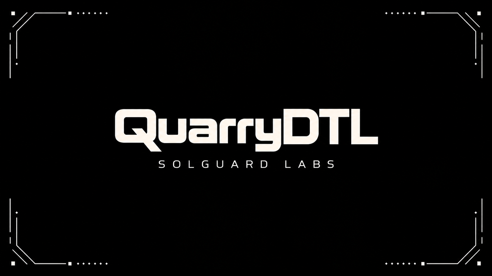
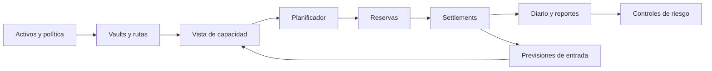

# QuarryDTL



QuarryDTL es un motor de tesorería y distribución de liquidez entre vaults. Su núcleo en Go mantiene reservas, demanda por ruta y settlements diferidos; la CLI emite estados JSON deterministas para que operaciones y sistemas de control puedan reproducir cada ciclo. Node.js ejecuta la compilación y las pruebas de integración, sin depender de servicios externos.

## Modelo operativo



Cada ruta tiene un origen, un destino, un activo, una demanda y un lote mínimo. El planificador ordena la demanda por prioridad, salud de ruta y capacidad. Los settlements atraviesan estados explícitos (`open`, `prepared`, `submitted` y un estado terminal); el diario conserva los cambios observables. El reporte incluye exposición por ruta, distribución de reservas, fees realizados e invariantes de integridad.

La vista por vault distingue:

```text
capacidad libre observada = max(idle − buffer mínimo, 0)
capacidad asignable = capacidad libre observada + previsión admisible
límite de ruta = min(capacidad asignable, cuota de ruta, demanda pendiente)
cobertura (bps) = reserva × 10 000 / pasivo
```

Las previsiones representan capacidad operativa bajo la política configurada; los importes finales solo se reconocen al completar el settlement. Consulte [modelo económico](docs/modelo-economico.md) para unidades, tarifas, liquidación y ejemplos numéricos.

## Primer uso

Requisitos: Go 1.22+, Node.js 24+.

```bash
npm install
npm run build
out/quarrydtl --list
out/quarrydtl scenario capacity-cycle
out/quarrydtl validate allocation
npm test
```

En Windows, el binario es `out/quarrydtl.exe` y puede utilizarse `npm.cmd`. `validate` devuelve un estado distinto de cero cuando las invariantes del escenario no pasan. La salida de `scenario` contiene `state_digest`, `views`, `settlements`, `exposure`, `risk`, `invariants` y `events`.

## Arquitectura y documentación

| Área | Responsabilidad |
| --- | --- |
| `src/ledger.go`, `src/vault.go` | Mutaciones de reserva, entradas y salidas pendientes. |
| `src/planner.go`, `src/allocator.go` | Capacidad, priorización y planes de asignación. |
| `src/rebalance.go`, `src/liquidation.go` | Ciclos operativos y recuperación de cobertura. |
| `src/settlement.go`, `src/forecast.go` | Estados de liquidación y previsiones. |
| `src/exposure.go`, `src/report.go`, `src/risk.go` | Exposición, JSON e invariantes. |

- [Arquitectura y estados](docs/arquitectura.md)
- [Modelo económico y ejemplos](docs/modelo-economico.md)
- [Operación y recuperación](docs/operacion.md)
- [Contrato de datos](docs/contrato-json.md)
- [Política de seguridad](SECURITY.md)

## Validación y entrega

`bash scripts/ci.sh` comprueba `gofmt`, `go vet`, `go test`, build y pruebas Node. El workflow ejecuta la misma secuencia en pull requests, ramas y versiones. Las ramas `main` y `production` representan la misma revisión de código en la versión publicada; la etiqueta anotada `v1.0.0` identifica ese commit.

El proyecto implementa un entorno determinista local; este repositorio por sí mismo no opera contratos en cadena, custodia activos ni requiere credenciales de red.
