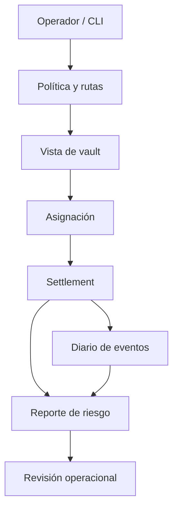

# Política de seguridad

## Límites de confianza

QuarryDTL separa configuración de activos y rutas, ejecución de órdenes operativas, mutaciones del ledger y reporting. La CLI ejecuta escenarios deterministas; no incluye una pasarela de depósitos, llaves de firma ni conexión a una red pública. No debe interpretarse la salida como prueba de custodia o finalización fuera de este motor.



## Controles verificables

- Las rutas enlazan vaults del mismo activo y aplican lote mínimo, demanda y cuota.
- Los importes son enteros; los porcentajes se expresan en puntos básicos (`10 000 = 100 %`).
- El ledger registra reservas, entradas y salidas pendientes, estado de settlement y eventos asociados.
- Las previsiones enlazan con el settlement que las originó y están sujetas a umbral de confianza.
- El reporte valida referencias, no negatividad y límites de demanda; `validate` falla si sus invariantes no se cumplen.
- La exposición por ruta desglosa importe enviado, finalizado y fallido sin mezclar fees no realizados.

Estos controles son condiciones comprobables, no una certificación de ausencia de riesgos. Las verificaciones locales no sustituyen revisión independiente, conciliación externa ni pruebas de integración con un custodio real.

## Revisión y notificación

Para comunicar un problema de seguridad, utilice el canal privado de avisos de seguridad del repositorio en GitHub. Incluya commit, secuencia de comandos, salida JSON, activo y ruta afectados, estado esperado/observado e impacto económico estimado. No publique datos sensibles ni reproducciones contra sistemas ajenos.

## Comprobación local

```bash
go vet ./...
go test ./...
bash scripts/ci.sh
out/quarrydtl validate operator-cycle
```

El [modelo económico](docs/modelo-economico.md) define las magnitudes; [operación](docs/operacion.md) describe el ciclo de revisión y recuperación.
