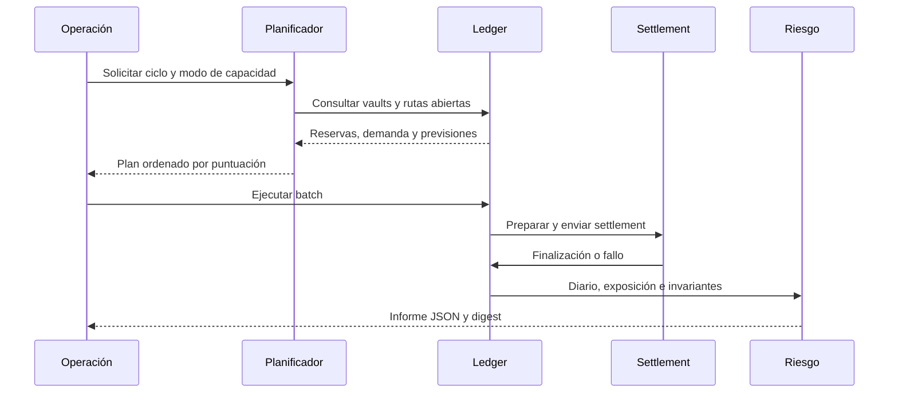
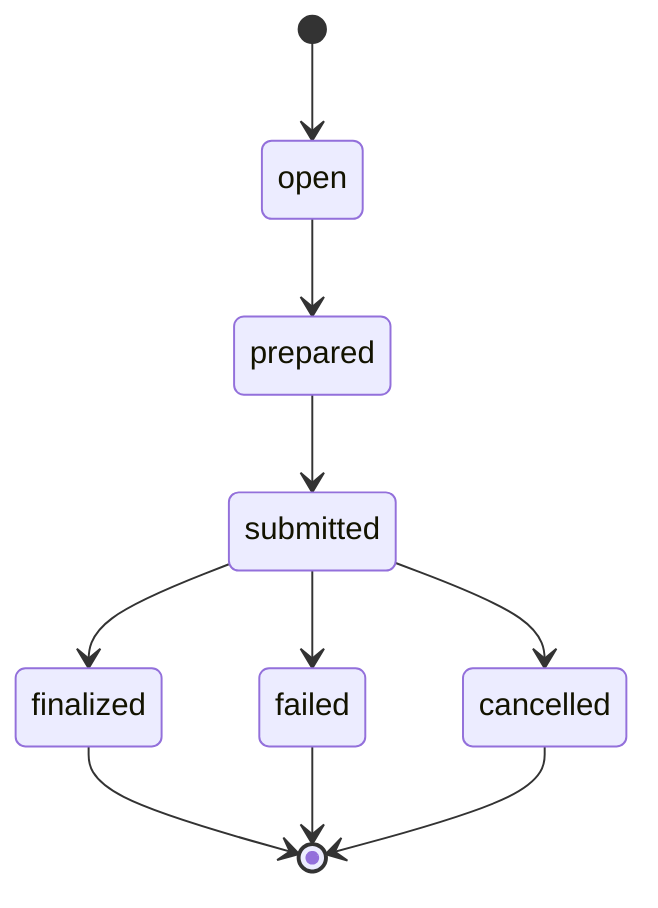

# Arquitectura y ciclo de estados

El ledger mantiene siete dominios: registro de activos, cuentas, vaults, rutas, settlements, reservas, previsiones y diario. Cada ejecución empieza desde una semilla reproducible; el reloj lógico avanza por ticks y no depende del reloj de la máquina.

`PlannerOptions` decide si la vista usa solo liquidez observada o también previsiones admitidas. `RouteCapacity` cruza la capacidad del vault con la cuota máxima de ruta y su demanda pendiente. `Allocator` produce planes y ejecuta cada uno contra `Ledger.OpenSettlement`. Un intent de rebalanceo limita a ocho settlements y tiene un lote mínimo propio.

El estado terminal determina cómo se computan `exposure.finalized`, `exposure.failed` y `fees_finalized`. Una previsión tiene ciclo independiente (`scheduled`, `observed`, `settled`, `voided`), identificado por `source_settlement`.

## Reproducibilidad

`state_digest` resume el estado serializado del ledger. Dos ejecuciones del mismo escenario, versión y configuración deben producir el mismo digest. Los IDs del secuenciador y el ordenamiento de rutas también son deterministas; una diferencia inesperada es motivo para revisar el commit, el escenario y la configuración antes de comparar importes.
