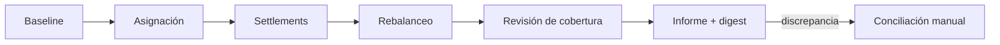

# Operación y recuperación

## Secuencia habitual

1. Verificar versión de Go y Node, instalar dependencias y ejecutar `npm run ci`.
2. Ejecutar `out/quarrydtl --list` para conocer los ciclos disponibles.
3. Consultar `baseline` para establecer reservas, rutas y digest inicial.
4. Ejecutar `allocation`, `rebalance` u `operator-cycle` según el proceso a revisar.
5. Guardar el JSON, el commit y el comando exacto que produjo el informe.
6. Revisar `invariants`, `risk` y `exposure` por activo y ruta, además del estado de cada settlement.



## Señales de revisión

- `validate` devuelve código distinto de cero.
- Una ruta llega al límite de utilización, conserva settlements submitted más tiempo del esperado o aumenta `failed`.
- El digest cambia para el mismo escenario y revisión.
- La cobertura de un vault cae por debajo del umbral configurado.
- Las sumas por activo del reporte divergen de la conciliación externa de la integración.

Ante una discrepancia, no reintente a ciegas un ciclo de liquidación. Conserve el JSON y el diario de eventos, identifique la ruta y el settlement, compruebe si el estado terminal fue observado y reconcilie las reservas antes de volver a planificar. El motor local no realiza pagos externos ni ofrece un mecanismo de reversión de pagos de terceros.

## Comandos de ejemplo

```bash
npm run build
out/quarrydtl scenario baseline
out/quarrydtl scenario operator-cycle
out/quarrydtl validate operator-cycle
npm test
```
